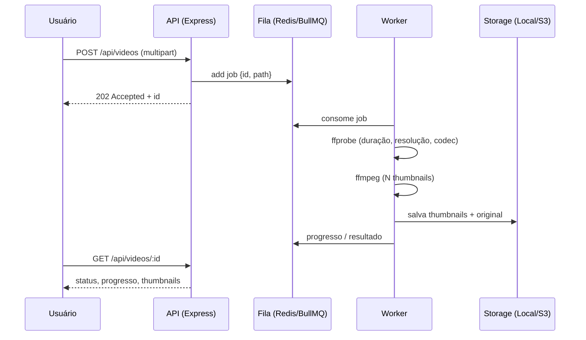

# 🎬 Video Pipeline

Simulador de **processamento de vídeos no estilo YouTube/Netflix**: o usuário faz upload, a API responde na hora e um **worker assíncrono** consome a fila, extrai metadados com **FFprobe**, gera **thumbnails com FFmpeg** e salva tudo em um **storage local ou AWS S3**.


## 🧠 Por que uma fila?

Processar vídeo é lento e pesado. Se a API fizesse isso dentro da requisição, o usuário ficaria esperando e o servidor travaria com poucos uploads simultâneos.
Com a fila, a API só **enfileira o trabalho** (HTTP 202) e quantos workers forem necessários processam em paralelo — com **retentativas automáticas** e **backoff exponencial** em caso de falha.



## ✨ Funcionalidades

- Upload multipart com limite de tamanho e filtro por tipo (`video/*`)
- Fila **BullMQ** com 3 tentativas e backoff exponencial
- Worker com concorrência configurável e **progresso em tempo real** (0–100%)
- Thumbnails distribuídas ao longo do vídeo, ignorando início e fim (telas pretas)
- Storage plugável: `local` (padrão) ou `s3` (AWS SDK v3)
- Página web simples para enviar vídeos e acompanhar o processamento
- Endpoint de métricas da fila (`/api/stats`)
- Testes com o test runner nativo do Node e CI no GitHub Actions

## 🚀 Como rodar

### Com Docker (recomendado)

```bash
docker compose up --build
```

Acesse **http://localhost:3000**, envie um vídeo e veja as thumbnails aparecerem.
Quer mais poder de processamento? `docker compose up --scale worker=3`

### Sem Docker

Requer Node.js 20+, Redis rodando e FFmpeg instalado no PATH.

```bash
npm install
cp .env.example .env
npm start          # terminal 1 — API
npm run worker     # terminal 2 — worker
```

## 📡 API

| Método | Rota | Descrição |
|-------|------|-----------|
| POST | `/api/videos` | Upload (campo `video`). Retorna `202` com o `id` |
| GET | `/api/videos/:id` | Status, progresso e resultado |
| GET | `/api/stats` | Jobs aguardando, ativos, concluídos e com falha |

Exemplo de resultado:

```json
{
  "id": "7f3c...",
  "status": "completed",
  "progresso": 100,
  "resultado": {
    "duracao": "02:14",
    "resolucao": "1920x1080",
    "codec": "h264",
    "thumbnails": [
      { "segundo": 13.4, "url": "/files/videos/7f3c.../thumb-1.jpg" },
      { "segundo": 67, "url": "/files/videos/7f3c.../thumb-2.jpg" },
      { "segundo": 120.6, "url": "/files/videos/7f3c.../thumb-3.jpg" }
    ]
  }
}
```

## ☁️ Usando AWS S3

```env
STORAGE_DRIVER=s3
S3_BUCKET=meu-bucket
AWS_REGION=us-east-1
```

As credenciais são lidas da cadeia padrão da AWS (variáveis de ambiente, `~/.aws/credentials` ou IAM role).

## 📁 Estrutura

```
src/
├── server.js        # API HTTP (upload + consulta)
├── worker.js        # Consumidor da fila
├── queue.js         # Configuração da fila BullMQ
├── ffmpeg.js        # Wrappers de ffprobe/ffmpeg
├── thumbnails.js    # Lógica pura (testável) de timestamps
└── storage/         # Drivers local e S3
public/index.html    # Interface de upload
test/                # Testes (node --test)
```

## 🗺️ Roadmap

- [ ] Transcodificação para HLS (360p/720p/1080p)
- [ ] Notificação via WebSocket em vez de polling
- [ ] Dashboard com Bull Board

---
Desenvolvido por [Weslei Sousa](https://github.com/joseweslei45-debug) · Licença MIT
